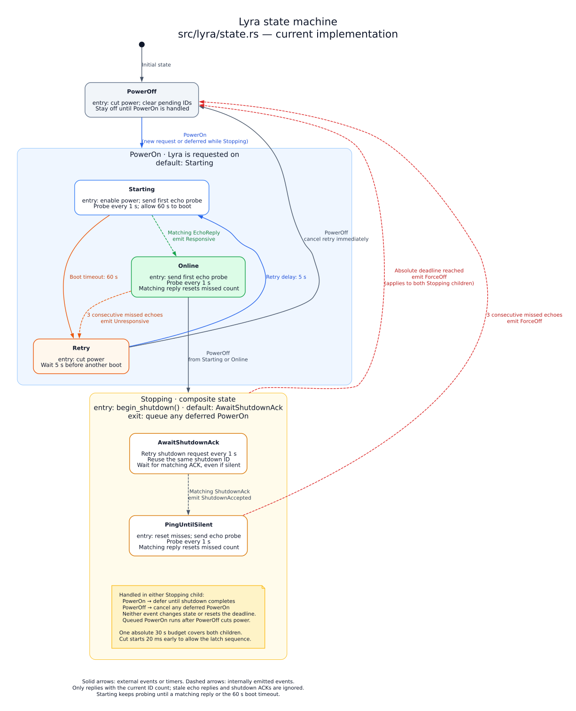

# nRF Manager architecture proposal

This document proposes the architecture; it does not describe an implemented
system. Diagrams are embedded SVG files in [docs/diagrams](docs/diagrams),
alongside their editable Graphviz `.dot` sources. They can also be opened
directly in an SVG viewer or browser.

## State machine boundaries

Use **two `hsmc` machines running in separate Embassy tasks**:

- **Vehicle supervisor:** decides whether the system is driving, observing a
  parked car, charging, or sleeping.
- **Lyra controller:** handles power, boot verification, UART health, retries,
  and graceful shutdown.

CAN, UART, e-ink and radio have their own tasks. They do not all need state
machines. The car can remain in `Driving` while Lyra moves through booting,
running and recovery.

The local `hsmc` supports hierarchical states but has no parallel regions. Its
[semantics document](<crates/hsmc/docs/002. hsmc-semantics-formal.md>) recommends
separate machines connected by channels for independent lifecycles.

## Vehicle supervisor

State hierarchy:


Flow within each vehicle mode:


`IgnitionOff` handles ignition-on for all its children. Charging, sleeping and
waiting for shutdown therefore share the same return path.

`LyraManaged` does not mirror the Lyra controller's boot, online and retry
states. It means the vehicle supervisor has requested Lyra ON and delegated
that lifecycle to the Lyra controller.

| Vehicle state | Lyra | nRF CAN activity | Display |
| --- | --- | --- | --- |
| Driving | Requested on; controller maintains it | Disabled, including during Lyra recovery | PID data received from Lyra |
| WaitingForLyraOff | Graceful shutdown in progress | Local polling disabled until handover | Last values, with their age |
| Observing | Off | Periodic OBC and car open/closed checks | Parked/charging detection status |
| Charging | Off | Periodic OBC and BMS reads | Charging information |
| ParkedSleep | Off | Sparse, bounded probe windows | Retained image; refresh when needed |

`ParkedSleep` is the name for the requested final "shutdown" mode because the
nRF must still wake for ignition, CAN probes and modem communication. Select a
hardware sleep mode that supports the required wake sources.

### Observation window

Store timestamps in the supervisor context:

- If the car is already closed at ignition-off, start the approximately
  five-minute observation window then.
- Otherwise, anchor that window to the subsequent closure.
- Use a longer, bounded policy while the car is open or its closure state is
  unknown.
- Repeated "still closed" responses must not restart the timer.

An OBC response enters `Charging`. BMS availability is tracked separately.
Confirm charging loss across multiple failed polls rather than treating one
missing response as the end of charging. Preserve the difference between
"not charging" and "data unavailable" in telemetry.

## Lyra controller

The Lyra controller owns the power pins. Other tasks request a desired state
and receive status updates; they never toggle Lyra power themselves.


### Boot, health and recovery

- **Boot readiness means an application handshake.** Linux boot output or
  arbitrary UART bytes do not establish that the PID service can answer
  requests.
- **Health uses valid protocol traffic and correlated replies.** Track PID
  freshness separately so that a responsive UART with stale vehicle data is
  visible.
- **Retries remain periodic while ignition is on.** Use a minimum power-off
  interval and a capped retry delay to avoid rapid cycling.
- **Requested OFF supersedes boot and recovery.** In `Retry`, power is
  already off, so the controller can enter `PowerOff` directly.

Boot deadlines, health intervals, missed-reply thresholds and retry delays are
configuration values to tune against actual Lyra behaviour.

### Graceful shutdown

1. On ignition-off, request Lyra OFF and record the absolute deadline:
   `ignition_fell_at + 30 seconds`.
2. Send a shutdown request and wait for its acknowledgement.
3. After acknowledgement, send a ping every second.
4. After the configured missed-reply threshold, cut power.
5. Cut power at the absolute deadline even if the acknowledgement never
   arrives or Lyra continues responding.

ACKs, pings and repeated OFF requests must not extend the deadline. Account
for command delivery and the power-switching sequence when enforcing it.

Define ACK as **shutdown accepted**. The Lyra ping responder must remain alive
until removing power is acceptable. Stopping the UART service early must not
be mistaken for completed shutdown. Use a small configurable missed-reply
threshold rather than cutting power after one lost reply, while remaining
within the overall deadline.

If ignition returns during shutdown, defer its `PowerOn` request until
shutdown and the power cut finish. Then handle it through the normal
`PowerOff` → `PowerOn` transition. A later `PowerOff` cancels the deferred
request. The vehicle supervisor can already be in `Driving` while the Lyra
controller finishes shutting down.

## Tasks and ownership

| Component | Responsibility | Use `hsmc`? |
| --- | --- | --- |
| Ignition monitor | Read initial level, debounce edges, preserve timestamps | No |
| Vehicle supervisor | Vehicle modes, observation deadlines, CAN policy and handover | Yes |
| Lyra controller | Power lifecycle, health deadlines, shutdown and retry policy | Yes |
| UART service | Persistent RX parser, serialized TX, request IDs and reply routing | Usually no |
| CAN service | Own controllers; execute polling profiles and bounded PID transactions | Usually no |
| Telemetry store | Merge values, track freshness/source, publish snapshots | No |
| Display task | Render latest snapshot, rate-limit refreshes, handle display busy | No initially |
| Modem/radio task | Own IEEE 802.15.4, exchange telemetry and incoming information | Optional later |

Each hardware resource has one owner. The UART service may use separate RX
and TX tasks, each owning its half of the transport.

### CAN handover

On ignition-on:

1. Stop scheduling local CAN requests.
2. Finish or abort the current transaction within a bounded time.
3. Report `CanQuiescent`.
4. Allow the Lyra controller to power up Lyra.

On ignition-off, enable local polling only after Lyra power has been cut.
There is no nRF CAN fallback during driving, including while Lyra boots or
recovers.

## Telemetry and modem data flow


Each stored PID carries at least:

- Value.
- Source: Lyra or local CAN.
- Observation time.
- Validity.

When ownership changes from Lyra to local CAN, old values remain identifiable
as stale. The display and modem consume the same normalized snapshot.

For information received from the modem, update local state immediately and
forward it when Lyra's application is ready. While Lyra is booting, retain
replaceable information as its latest value; give commands a bounded queue
and expiry. Old commands must not accumulate indefinitely while Lyra is off.

Radio reception windows can be adjusted by vehicle mode to balance delivery
latency and parking power consumption. The modem and nRF need an agreed
receive-window policy if immediate reception is not maintained.

## Lyra UART protocol

Use `postcard-rpc` over the full-duplex UART. The nRF is the RPC server and
Lyra is the Linux host client. These protocol roles are independent of power
authority: the nRF remains responsible for Lyra power and vehicle policy.

Endpoint requests originate from Lyra. Topics can be sent by either side,
so the nRF can initiate a health probe or shutdown without waiting for Lyra
to poll. Paired topics need explicit command IDs, acknowledgements and
timeouts; they do not automatically become request/response endpoints.

The initial implementation is in [src/lyra/rpc.rs](src/lyra/rpc.rs). It uses
buffered UART reception at 115200 baud, 8N1, and COBS-delimited frames. Its
`lyra/echo` endpoint returns up to 128 arbitrary bytes unchanged, including
zero bytes. Standard postcard-rpc ping and schema endpoints are also
provided by the dispatcher. COBS provides framing, not a checksum; integrity
checking remains a transport design item before relying on control messages.

Shared endpoint definitions and wire types live in the small `no_std` crate
[crates/lyra-protocol](crates/lyra-protocol). A separate crate is not required
by UART itself, but gives both programs one definition of their protocol,
including endpoint keys and payload limits. Keep hardware drivers and handlers
in their respective applications.

Both applications must use the same `postcard-rpc` dependency source. The
firmware and protocol crate pin upstream revision
`2469ebc614108ac2ab68d923d50c8da4c9f3e91d`, which provides the
`embedded-io-async-0_7-server` adapter and supports Embassy executor 0.10.
The released 0.12.1 adapter targets older versions. The adapter still needs
Embassy sync 0.7 internally; the rest of this firmware keeps sync 0.8.

For a Lyra client, add a path dependency on `lyra-protocol`, use the same
`postcard-rpc` revision with its `use-std` and `cobs-serial` features, and run
the following from a Tokio runtime. Replace the serial device path with
Lyra's actual connection:

```rust
use lyra_protocol::{EchoEndpoint, EchoPayload};
use postcard_rpc::{
    header::VarSeqKind,
    host_client::HostClient,
    standard_icd::WireError,
};

let client = HostClient::<WireError>::try_new_serial_cobs(
    "/dev/ttyS1", "error", 8, 115_200, VarSeqKind::Seq2,
).expect("open nRF serial port");

let request = EchoPayload::from_slice(b"hello nRF\0").unwrap();
let response = client.send_resp::<EchoEndpoint>(&request).await.unwrap();
assert_eq!(response, request);
```

The ignition/car tasks drive [src/lyra/state.rs](src/lyra/state.rs), which owns
the power latch. The RPC transport is initialized first and shares its sender
with this controller. The implemented chart is shown below; the earlier Lyra
diagram describes the architecture proposal.



Editable source: [lyra-state.dot](docs/diagrams/lyra-state.dot).

`PowerOn` represents the requested-on lifecycle and contains `Starting`,
`Online` and `Retry`. `Starting` enables hardware power on each boot attempt.
`Retry` cuts power, waits five seconds and returns to `Starting`; a `PowerOff`
request in `Retry` enters the outer `PowerOff` state immediately.

Its current defaults are:

- Probe Lyra once per second after power-on; a matching reply enters `Online`.
- Allow 60 seconds for boot, then cut power and wait five seconds before retry.
- In `Online`, three consecutive missed replies trigger the same recovery.
- On `PowerOff` from `Starting` or `Online`, send and retry one shutdown
  request ID once per second.
- After its matching ACK, probe once per second and cut power after three
  consecutive missed replies.
- Enforce one absolute 30-second shutdown budget, including when no ACK
  arrives. Start the latch sequence 20 ms before the deadline to allow its
  15 ms GPIO sequence to complete. UART sends are bounded and use the
  remaining deadline when stopping.
- A `PowerOn` received during `Stopping` is deferred until shutdown and the
  power cut finish, then processed normally without entering `Retry`.
  Another `PowerOff` cancels the pending `PowerOn`. Duplicate requests and
  ACKs do not reset the shutdown deadline.

Control messages use a `u64` ID in the message body. Lyra must subscribe to
both outgoing topics before relying on this lifecycle:

| Topic | Direction | Lyra behaviour |
| --- | --- | --- |
| `lyra/echo/probe` | nRF to Lyra | Publish the same ID on `lyra/echo/reply` |
| `lyra/echo/reply` | Lyra to nRF | Reply to the current probe; old IDs are ignored |
| `lyra/shutdown/request` | nRF to Lyra | Accept once per ID and publish that ID on `lyra/shutdown/ack` |
| `lyra/shutdown/ack` | Lyra to nRF | Confirm acceptance, then remain responsive until it is safe to cut power |

The existing `lyra/echo` endpoint still tests requests from Lyra to the nRF.
It does not answer nRF-initiated probes. Echo health currently establishes
that Lyra's control handler responds; PID acquisition readiness and freshness
still need separate reporting. The Linux-side topic handlers are not yet
implemented here.

The host tests run the actual `hsmc` chart with mock power and UART output,
and a controllable Embassy clock:

```sh
cargo test --manifest-path tests/lyra-state/Cargo.toml \
  --target x86_64-unknown-linux-gnu --target-dir /tmp/nrf-lyra-state-tests-target
```

The following messages are proposed for later implementation:

| Message | Direction | Mechanism |
| --- | --- | --- |
| Application ready, protocol version and boot ID | Lyra to nRF | Topic |
| PID snapshot | Lyra to nRF | Topic |
| Information received from the modem | nRF to Lyra | Topic |
| Read manager status | Lyra to nRF | Endpoint |

Lyra should install its incoming topic subscriptions before announcing
readiness. UART handlers deliver events to the Lyra controller; that
controller owns retry policy and the absolute 30-second shutdown deadline.

Ergot remains an alternative if services need symmetric RPC initiation or
the project grows into an addressed network spanning Lyra, the nRF and the
modem. That would require suitable radio transport integration. Its wider
routing scope is not needed for this initial point-to-point echo server.

References: [postcard-rpc communication model](https://docs.rs/postcard-rpc/latest/postcard_rpc/),
[Ergot messaging model](https://docs.rs/ergot/latest/ergot/book/_02_major_concepts/index.html),
[Ergot project status](https://docs.rs/ergot/latest/ergot/).

## Inter-task communication

Use two communication patterns:

- **Bounded channels for commands and completion events:** `CanQuiescent`,
  `LyraPoweredOff`, shutdown ACKs and transaction results. Give each channel
  an intended consumer.
- **`Watch` for latest snapshots and current status:** display and radio can
  skip intermediate telemetry updates.

Embassy's [`Watch`](https://docs.embassy.dev/embassy-sync/0.8.0/default/watch/index.html)
supports multiple receivers and overwrites the previous value. Ordinary
[`Channel`](https://docs.embassy.dev/embassy-sync/0.8.0/default/channel/index.html)
receivers compete for messages; a single channel is not a broadcast bus.

Keep raw PID traffic out of the supervisor's event queue. Send it sparse
facts such as `ObcDetected`, `ChargingLost` and `CarClosedChanged`. Preserve
ignition level and edge timestamps, and deliver ignition changes reliably.

Tag asynchronous work with a generation number. A late OBC reply from an old
parked polling cycle must not switch the system into charging after ignition
has risen. The same principle applies to stale UART replies after a Lyra
restart and results from cancelled polling profiles.

## Using `hsmc`

- Put shared transitions on parent states, such as ignition-on on
  `IgnitionOff` and the overall shutdown deadline on `Stopping`.
- Use `on(after ...)` for fixed state-scoped deadlines and `on(every ...)`
  for periodic policy checks. For deadlines anchored to an external event,
  retain the absolute timestamp and account for elapsed time.
- The local crate has no transition guards. For context-dependent decisions,
  have an action evaluate the context and emit a typed follow-up event that
  selects the next state.
- Keep chart actions short. Send commands and handle completion events
  instead of awaiting an entire boot, CAN exchange or display refresh inside
  an action.
- Use `during:` for cancellation-safe waits. The local implementation can
  drop these futures when events or timers arrive, so persistent UART parsing
  and multi-step hardware transactions belong in their owning tasks. See the
  [cancellation contract](crates/hsmc/README.md#cancel-safety-contract).
- Keep long peripheral initialization and recovery outside the ignition
  supervision startup path.
- Do not terminate the vehicle chart when entering `ParkedSleep`; it must
  remain able to process wakeups and return to driving or charging.

Start with the two machines described here. Add another only when a
subsystem develops its own substantial lifecycle, such as radio
association/retry/sleep states or display recovery.

## Hardware scheduling considerations

- Share SPI only around actual transactions. An e-ink refresh must release
  the bus while waiting for the panel, allowing CAN access.
- Rate-limit display refreshes and coalesce pending updates to the newest
  snapshot.
- Validate parked probe behaviour on the car. Probe frequency affects both
  detection latency and whether ECUs are allowed to stay asleep.
- Keep all CAN transactions and receive windows bounded so that ignition
  changes remain responsive.
